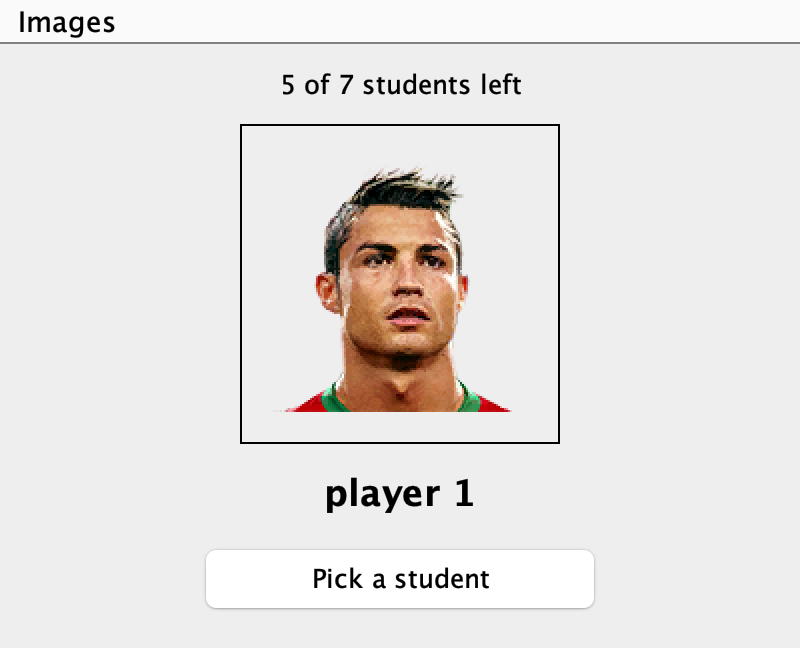

# Player Chooser

A Java desktop app that picks students to participate in class. Student photos cycle on screen
until you stop them, and the student shown is picked. **Each student is picked only once per
session**, so everyone gets a turn before anyone repeats. A session lasts until the app is closed.



## Features

- **Fair turns:** a picked student leaves the pool for the rest of the session. The window shows
  their name and how many students are left, and tells you when everyone has participated.
- **Start/Stop button:** "Pick a student" starts the photos cycling and becomes "Stop". Clicking
  the photo also stops it.
- **Your own class or demo images:** the **Images** menu offers **Load my images…** (choose a
  folder of class photos) and **Load demo images** (bundled sample photos, handy for trying the
  app out). Loading a new set starts a new session; the app asks first if students have already
  participated.
- **Any photo size:** large photos, such as phone pictures, are scaled down to fit. They load in
  the background; until a photo is ready, the student's name is shown in its place.

## Requirements

- Java 21 or newer
- Maven, to build it (tested with Maven 3.9.9)

## Build and run

```bash
mvn package
java -jar target/player-chooser-1.0-SNAPSHOT.jar
```

## Preparing your class photos

1. Put one photo per student in a folder. Supported formats: PNG, JPG/JPEG, GIF.
   - iPhone photos are often HEIC, which isn't supported: export them as JPG first.
   - Phone photos taken in portrait may appear sideways, because the app doesn't read the
     rotation stored in the photo. Rotate and save them in a photo editor if that happens.
2. Name each photo after the student. The name shown is the file name without the extension, with
   underscores turned into spaces: `maria_lopez.jpg` is shown as **maria lopez**. Names must be
   unique: if two photos give the same name (`ana.png` and `Ana.jpg`), only one is used.
3. Load the folder in any of these ways:
   - Choose **Images → Load my images…** in the app.
   - Name the folder `img` and start the app from the folder that contains it.
   - Pass the folder when starting the app:
     ```bash
     java -jar player-chooser-1.0-SNAPSHOT.jar /path/to/class-3B
     ```

At startup the app uses, in order: the folder given on the command line, an `img` folder in the
current directory, or the demo images.

## Development

```bash
mvn test                      # all tests; window tests are skipped without a display (e.g. CI)
mvn test -Dui.dialogs=true    # also drives the folder chooser and message dialogs (they flash on screen)
```

`PlayerChooserUiTest` drives the real window without showing it: full sessions, Start/Stop,
switching image sets, and that the window doesn't freeze while large photos load.

To regenerate the README screenshot:

```bash
mvn test-compile
java -cp target/classes:target/test-classes net.mazatlab.ScreenshotTool docs/screenshot.png
```

The picking rules live in `StudentPool` and are tested without a display. `ImageChooser` loads the
photos (from a folder, or the demo images bundled in the jar), and `PlayerChooser` is the Swing
window.

| Class | Responsibility |
|---|---|
| `PlayerChooser` | Swing window: menu, photo, name, counter, Start/Stop button |
| `StudentPool` | Students left in this session; picking removes them |
| `ImageChooser` | Finds the photos and decides which set to load at startup |
| `Student` | A student's name (from the file name) and photo |

The demo images are photos of football players and are only meant for trying the app out.
